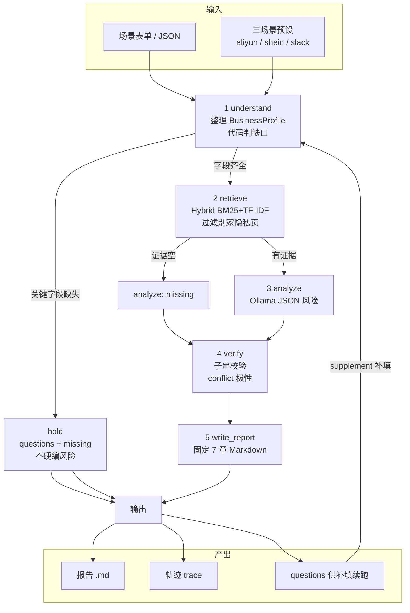

# ComplianceFlow 架构图（一页）

P10 固定五步流水线。模型不决定下一步；检索与校验不调模型。

## 组件落点

| 层 | 路径 | 职责 |
| --- | --- | --- |
| Web | `web/index.html` | 填表、看轨迹、预览/下载报告、缺信息补填 |
| API | `app/api.py` | FastAPI：`/api/scenarios`、`/api/run`、报告下载 |
| 编排 | `app/workflow.py` | LangGraph 固定边；hold / retrieve / analyze / verify / write |
| Schema | `app/schemas.py` | 步骤间字段约定 |
| RAG | `app/rag/corpus.py` + `index.py` | 切段（句界）+ 混合检索 |
| 语料 | `data/corpus/` + `catalog.json` | 仅可打开的公开原文 |
| 评测 | `data/eval/retrieval_cases.json` | 15 条 Hit@5 期望原句 |

## 风险状态

`supported` → 引用是原文子串  
`assumption` → 对不上或无有效引用  
`missing` → 缺字段 / 无证据，不编造  
`conflict` → 适用范围相反，两边保留

## 运行入口

- CLI：`scripts/run_scenario.py`、`scripts/run_eval.py`  
- Web：`scripts/run_web.py` → http://127.0.0.1:8000
